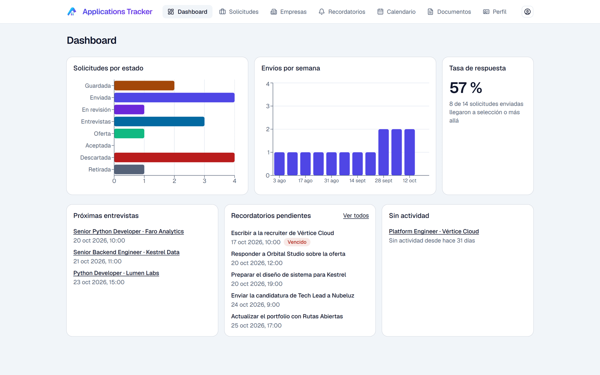
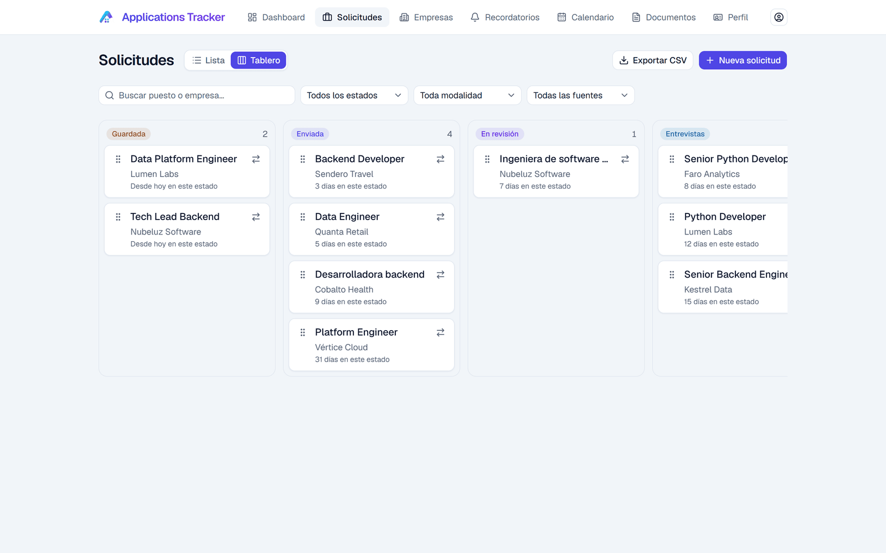
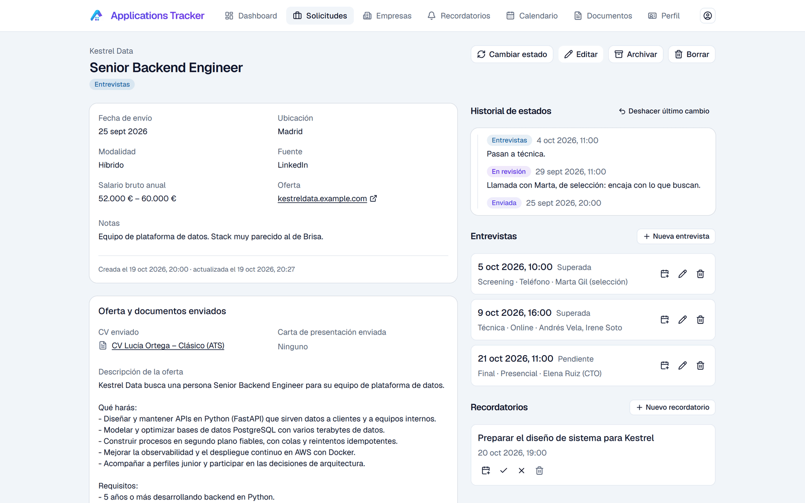
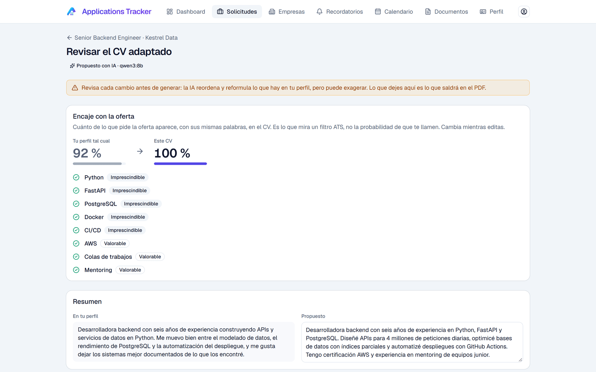
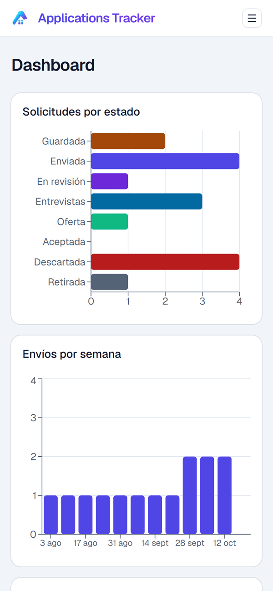
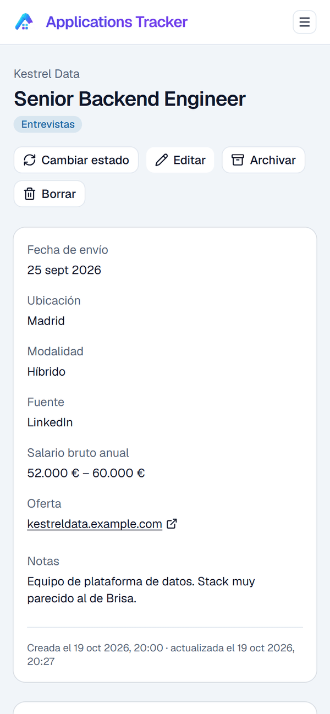
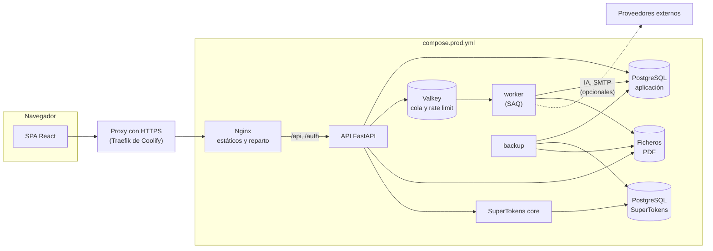

<div align="center">


# Applications Tracker

**Todas tus candidaturas, su historia y tu próximo paso, en un solo sitio.**

Un cuaderno de bitácora para la búsqueda de empleo: registra cada solicitud y cómo avanza, prepara el CV y la carta de cada oferta, y te avisa de lo que toca hacer después para que ninguna candidatura se quede olvidada.

[](https://github.com/iMiguel10/applications-tracker/actions/workflows/ci.yml)


</div>

---

<picture>
  <source media="(prefers-color-scheme: dark)" srcset="docs/images/dashboard-dark.png" />
  
</picture>

## Contenido

- [Funcionalidades](#funcionalidades)
- [Capturas](#capturas)
- [Arquitectura](#arquitectura)
- [Stack](#stack)
- [Puesta en marcha](#puesta-en-marcha)
- [Despliegue en producción](#despliegue-en-producción)
- [Desarrollo](#desarrollo)
- [Calidad y pruebas](#calidad-y-pruebas)
- [Documentación](#documentación)
- [Estructura del repositorio](#estructura-del-repositorio)
- [Seguridad](#seguridad)
- [Contribuir](#contribuir)
- [Licencia](#licencia)

## Funcionalidades

| | |
|---|---|
| **Solicitudes y empresas** | Alta, edición, archivado y borrado. Listado con búsqueda, filtros, orden y paginación **en la URL**, y empresas reutilizables entre solicitudes. |
| **Ciclo de vida** | Cada solicitud recorre una máquina de estados (guardada → enviada → en revisión → entrevistas → oferta → aceptada, o descartada / retirada) con un historial fechado y la opción de **deshacer** el último cambio. |
| **Tablero Kanban** | Las mismas solicitudes por columnas de estado: se mueven arrastrando, o desde el teclado con **Mover a…**, y solo se admiten las transiciones válidas. |
| **Entrevistas, recordatorios y calendario** | Entrevistas por solicitud y recordatorios con fecha límite, en un calendario mensual y semanal en tu zona horaria. Cada evento se puede añadir a Google Calendar o descargar como `.ics`. |
| **Documentos** | Biblioteca de CVs y cartas en PDF (subir, ver, descargar, renombrar, archivar) y el CV, la carta y la descripción de la oferta de cada solicitud, con cuota de almacenamiento por cuenta. |
| **Perfil y CVs generados** | Un perfil profesional (experiencia, formación, proyectos, certificaciones, habilidades e idiomas) del que salen CVs en PDF con cuatro diseños, tres de ellos aptos para ATS. |
| **CV y carta adaptados con IA** | La IA adapta el CV y escribe la carta de una oferta concreta **sin inventar experiencia**: cada cambio cita su origen en tu perfil y se revisa junto al original antes de generar el PDF. El encaje con la oferta, antes y después, lo calcula la aplicación, no la IA. Usos gratuitos con la IA de la instalación (por ejemplo, un Ollama propio) o tu propia clave de Anthropic, OpenAI o Groq, guardada cifrada. |
| **Avisos por email** | Recordatorio vencido, entrevista próxima, solicitudes sin actividad, resumen semanal y propuesta de IA terminada, cada uno activable por separado, nunca dos veces por el mismo motivo y con baja de un clic. |
| **Dashboard** | Solicitudes por estado, envíos por semana, tasa de respuesta, próximas entrevistas, recordatorios pendientes y solicitudes sin actividad. |
| **Métricas honestas** | Cada porcentaje indica sobre cuántas solicitudes se calcula y no se muestra con menos de 5. Nunca se da por descartada una candidatura que solo lleva tiempo sin respuesta. |
| **Cuenta** | Verificación de email, recuperación de contraseña, límites de uso visibles, exportación completa a CSV y borrado de la cuenta con todos sus datos. El registro puede cerrarse y las cuentas crearse con un script. |
| **Interfaz** | Español e inglés, tema claro u oscuro, diseño adaptable a móvil y accesibilidad trabajada (contraste AA medido, navegación por teclado, errores enlazados a sus campos). |

## Capturas

Datos de demostración: una persona y unas empresas inventadas.

| | |
|---|---|
|  |  |
| **Tablero.** Mover una tarjeta cambia su estado, con deshacer. | **Detalle.** Historial de estados, entrevistas, recordatorios y documentos enviados. |
|  |   |
| **CV adaptado con IA.** El encaje con la oferta lo calcula la aplicación; cada cambio se revisa junto al original. | **Móvil.** La misma aplicación, adaptada a pantallas pequeñas. |

## Arquitectura



Decisiones destacadas:

- **Capas verificables.** `endpoints → services → repositories`, resumidas en una regla: *si habla con la base de datos, vive en `repositories/`; si decide, vive en `services/` o `domain/`*. Lo que habla con otro sistema (disco, cola, correo, IA, PDF) vive en `infra/` detrás de una interfaz.
- **Máquina de estados con historial append-only.** Las transiciones solo las valida el backend, y el historial se ordena por una secuencia de la base de datos, no por fechas.
- **Aislamiento entre usuarios en dos capas:** filtro obligatorio por usuario en cada consulta y claves foráneas compuestas que impiden enlazar datos de otro usuario desde la propia base de datos. Un recurso ajeno responde 404, nunca 403.
- **Lo lento, en segundo plano.** Los PDF, los emails y las llamadas a la IA los hace un `worker`. Se encola siempre después de confirmar la transacción, y unos barridos recuperan lo que se quede a medias.
- **IA acotada.** A la IA solo llega lo imprescindible, sin datos de contacto. Lo que devuelve se valida contra el perfil antes de guardarse, y nada pasa al CV sin la revisión del usuario.
- **Emails sin duplicados.** Cada aviso se reclama y se confirma en la base de datos antes de hablar con el servidor de correo, y solo se reintenta lo que con seguridad no salió.
- **Documentación que no envejece:** la referencia de la API se genera del contrato OpenAPI y un test comprueba que está al día.

Cada decisión, con la alternativa descartada y el porqué, está en la [documentación de arquitectura](docs/arquitectura/index.md) y en la [bitácora de decisiones](docs/decisiones/index.md).

## Stack

| Capa | Tecnologías |
|---|---|
| **Backend** | Python 3.12 · FastAPI · SQLAlchemy 2 (async) · Alembic · Pydantic · uv |
| **Base de datos** | PostgreSQL 17 |
| **Autenticación** | SuperTokens (core propio con su base de datos) |
| **Segundo plano** | SAQ sobre Valkey · WeasyPrint · SMTP |
| **IA** | Anthropic · OpenAI · Groq · Ollama, detrás de una interfaz común |
| **Frontend** | React 19 · TypeScript · Vite · TanStack Query · react-hook-form + zod · Tailwind CSS v4 · shadcn/ui · dnd-kit · i18next · Recharts |
| **Producción** | Docker Compose · Nginx · Coolify (Traefik y Let's Encrypt) |
| **Calidad** | pytest · Vitest + Testing Library · ruff · mypy · ESLint · GitHub Actions |
| **Documentación** | MkDocs Material (desarrollo) · Docusaurus (producción, es + en) · Mermaid · OpenAPI |

## Puesta en marcha

Requisito: [Docker](https://docs.docker.com/get-docker/) con Docker Compose v2. Python, Node y PostgreSQL corren dentro de los contenedores.

```bash
git clone https://github.com/iMiguel10/applications-tracker.git
cd applications-tracker
cp .env.example .env
docker compose up --build
```

La primera vez se construyen las imágenes y el backend aplica las migraciones al arrancar. Cuando todo esté levantado:

| Servicio | URL |
|---|---|
| Aplicación | http://localhost:5173 |
| API (OpenAPI interactivo) | http://localhost:8000/docs |
| Documentación de desarrollo | http://localhost:8001 |
| Manual de uso, despliegue y API | http://localhost:3001 |
| Correo capturado (Mailpit) | http://localhost:8025 |

Crea una cuenta desde la pantalla de registro y empieza a registrar solicitudes. La IA de desarrollo es un Ollama local: el modelo se descarga una vez con `docker compose exec ollama ollama pull qwen3:8b`.

> [!IMPORTANT]
> Usa siempre `localhost`, nunca `127.0.0.1`. Para el navegador son sitios distintos: las cookies de sesión no viajarían y el inicio de sesión parecería no funcionar, sin ningún error.

## Despliegue en producción

La producción es [`compose.prod.yml`](compose.prod.yml), que no publica ningún puerto y se pone detrás de cualquier proxy con HTTPS. Está probada en [Coolify](https://coolify.io):

- **Un solo dominio.** Un Nginx propio sirve la aplicación y el manual compilados, reparte `/api` y `/auth` a la API, y añade el rate limiting de primera capa y las cabeceras de seguridad.
- **Configuración solo con variables.** Las variables están explicadas en [`.env.prod.example`](.env.prod.example). El correo, la IA de la plataforma y el envío de copias fuera del servidor son opcionales: se activan rellenando variables, sin tocar el código.
- **Copias de seguridad cada noche** de las dos bases de datos y los ficheros, con retención y restauración probada.
- **Despliegue continuo:** cada push a `main` que pasa la integración continua se despliega solo, y el job comprueba que la versión desplegada es la que pasó las pruebas.

La receta paso a paso, las variables y las copias de seguridad están en el manual (sección **Despliegue**).

## Desarrollo

Los comandos se ejecutan dentro de los contenedores. Los más habituales:

```bash
# Backend: estilo, tipos y migraciones
docker compose exec api ruff check .
docker compose exec api mypy app tests evals
docker compose exec api alembic revision --autogenerate -m "descripcion"

# Frontend: lint, tipos, tests y build
docker compose exec frontend npm run lint
docker compose exec frontend npx tsc -b
docker compose exec frontend npm run test
docker compose exec frontend npm run build

# Tests del backend contra una base de datos aislada
cp .env.test.example .env.test
docker compose -f compose.test.yml up --build --abort-on-container-exit --exit-code-from api-test
docker compose -f compose.test.yml down -v
```

> [!TIP]
> Las dependencias se instalan **dentro del contenedor en marcha** (`docker compose exec api uv add …`, `docker compose exec frontend npm install …`), nunca con `run`: los volúmenes de dependencias no se actualizan al reconstruir la imagen. La lista completa de comandos, convenciones y trampas conocidas está en [CLAUDE.md](CLAUDE.md).

## Calidad y pruebas

- **Backend:** más de 1 100 pruebas de repositories, services y API contra PostgreSQL real, cada una dentro de una transacción que se revierte al terminar. Incluyen **pruebas adversas**:
  - un usuario intenta leer, editar y borrar los recursos de otro en cada endpoint (la lista se lee del OpenAPI, así que un endpoint nuevo queda cubierto solo);
  - transiciones de estado inválidas;
  - carreras entre peticiones simultáneas;
  - el mismo email enviado dos veces a la vez;
  - cuotas que se intentan esquivar;
  - respuestas de la IA que inventan o citan lo que no existe.
- **Frontend:** Vitest y Testing Library para schemas, utilidades, hooks y componentes con lógica.
- **Autenticación:** pruebas contra el core real de SuperTokens.
- **IA:** una evaluación manual con casos inventados mide cada modelo con el mismo código que se ejecuta en producción.
- **Rendimiento:** un script mide el listado y el dashboard con 2 000 solicitudes por usuario contra su presupuesto (300 ms y 500 ms en p95).

La integración continua ([`ci.yml`](.github/workflows/ci.yml)) corre en cada push y pull request:
- lint y tipos del backend, y sus pruebas;
- frontend: lint, tipos, pruebas y build;
- construcción estricta de los dos sitios de documentación;
- construcción de las imágenes de producción, con la validación de Nginx y de `compose.prod.yml`;
- en `main`, el despliegue.

## Documentación

Hay dos sitios, cada uno para un público:

- **Manual** ([`manual/`](manual/), Docusaurus), en español y en inglés, para quien **usa**, **despliega** o **se integra** con la aplicación: una página por tarea, el despliegue paso a paso y la referencia de la API generada del contrato OpenAPI. En producción se sirve en `/manual/`.
- **Documentación de desarrollo** ([`docs/`](docs/), MkDocs), para quien trabaja en el código:

| Sección | Contenido |
|---|---|
| [Especificación](docs/producto/especificacion.md) | Requisitos numerados, ciclo de vida, límites, fases y riesgos |
| [Arquitectura](docs/arquitectura/index.md) | Decisiones con la alternativa descartada, modelo de datos, flujos e invariantes |
| [Arquitectura de la v2](docs/arquitectura/v2.md) | Segundo plano y emails, ficheros, IA, límites y abuso, cada tema con sus trampas |
| [Servicios y estructura](docs/arquitectura/servicios-y-estructura.md) | Servicios, estructura de carpetas, reglas de capas y producción |
| [Autenticación](docs/arquitectura/autenticacion.md) | Integración con SuperTokens y sus trampas |
| [Decisiones](docs/decisiones/index.md) | Bitácora de los cambios de rumbo durante el desarrollo |

## Estructura del repositorio

```
applications-tracker/
├── backend/                 API FastAPI y worker
│   ├── app/
│   │   ├── api/v1/          endpoints y dependencias (sesión, services)
│   │   ├── services/        reglas de negocio y transacciones
│   │   ├── repositories/    todo el acceso a datos
│   │   ├── domain/          reglas puras: estados, límites, IA…
│   │   ├── infra/           cola, correo, ficheros, PDF, IA y rate limit, tras una interfaz
│   │   ├── jobs/            trabajos del worker
│   │   ├── templates/       emails y diseños de CV
│   │   ├── models/          tablas SQLAlchemy
│   │   └── schemas/         entrada y salida (Pydantic)
│   ├── migrations/          migraciones de Alembic
│   ├── evals/               evaluación manual de la IA
│   └── tests/
├── frontend/                SPA React
│   └── src/
│       ├── features/        una carpeta por funcionalidad
│       ├── pages/           una página por ruta
│       └── shared/          UI, formularios, layout, i18n y utilidades
├── deploy/                  producción: Nginx (web), copias de seguridad y despliegue continuo
├── docs/                    documentación de desarrollo (MkDocs)
├── manual/                  manual de uso, despliegue y API (Docusaurus, es + en)
├── .github/workflows/       integración y despliegue continuos
├── compose.yml              entorno de desarrollo
├── compose.test.yml         entorno de pruebas del backend
└── compose.prod.yml         producción
```

## Seguridad

- **Sesiones** con SuperTokens: cookies httpOnly y `Secure`, refresh token que rota en cada uso y protección anti-CSRF.
- **Aislamiento** entre usuarios en cada consulta, comprobado con pruebas adversas en el CI.
- **Rate limiting** en dos capas: Nginx frena el abuso masivo, y la aplicación limita por IP real, por email y por usuario.
- **Cabeceras de seguridad** con una CSP estricta y HSTS.
- **Claves de IA de los usuarios** cifradas en la base de datos; solo se descifran dentro del worker durante la llamada.
- **Ficheros** guardados fuera de la ruta pública, con nombres generados y tamaño limitado al leerlos.

Si encuentras una vulnerabilidad, **no abras un issue público**: contacta con el autor a través de [su perfil de GitHub](https://github.com/iMiguel10).

## Contribuir

- Commits con el formato `tipo: descripción` (`feat`, `fix`, `docs`, `test`, `refactor`, `chore`), en español.
- Código en inglés; interfaz, comentarios y documentación en español.
- Cada cambio llega con sus pruebas y con su documentación **en el mismo commit**.
- Antes de subir, `ruff`, `mypy`, ESLint, `tsc` y las pruebas deben pasar sin errores; el CI lo comprueba.

Las convenciones completas, las reglas de capas y los invariantes que no se pueden romper están en [CLAUDE.md](CLAUDE.md).

## Licencia

Este repositorio **no tiene licencia**: el código está disponible para consulta, pero se reservan todos los derechos.

---

<div align="center">

Hecho por [Miguel Jiménez Cazorla](https://github.com/iMiguel10)

</div>
